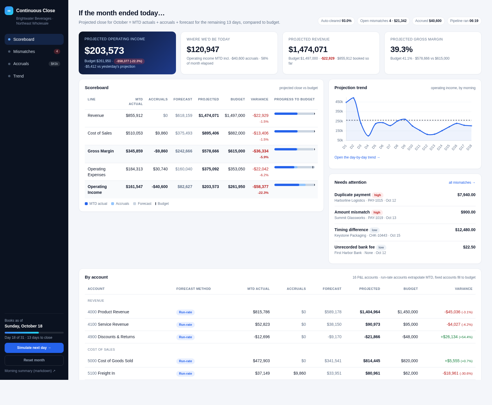
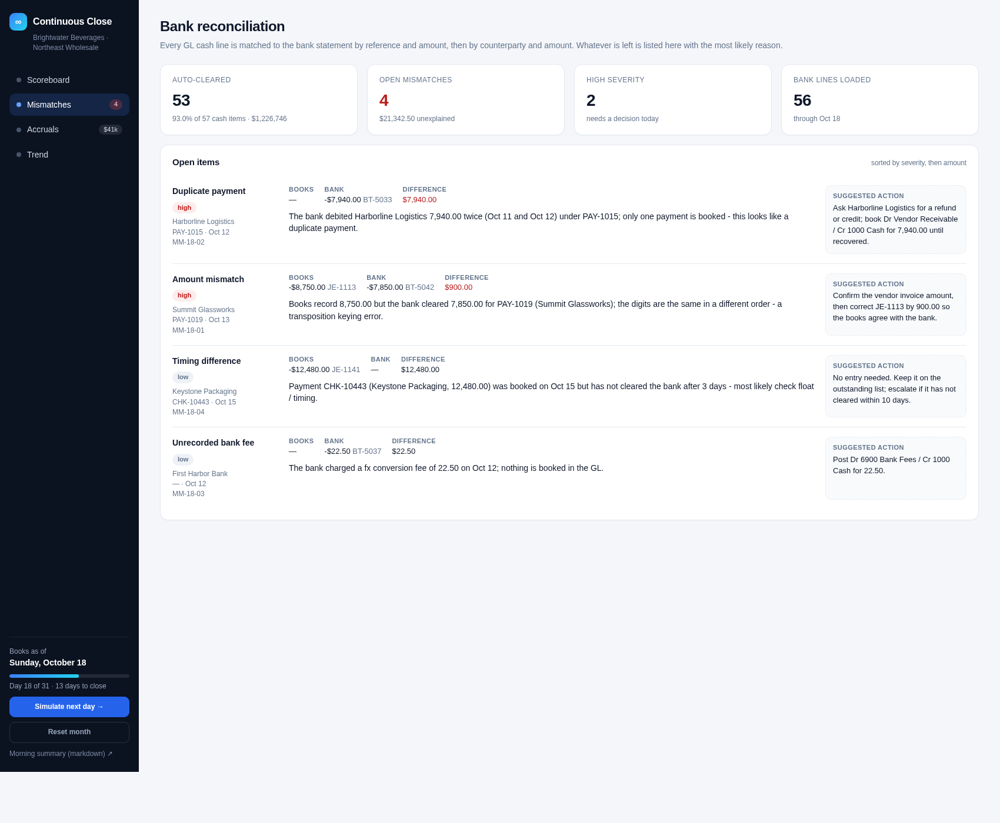
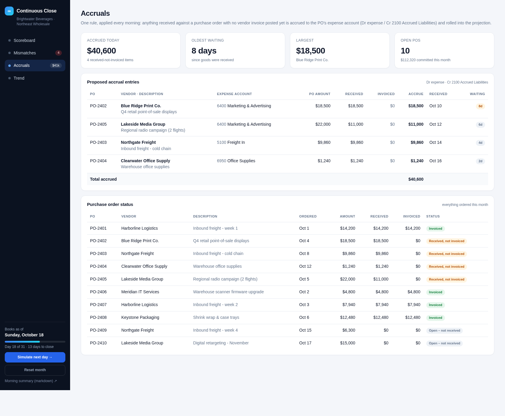
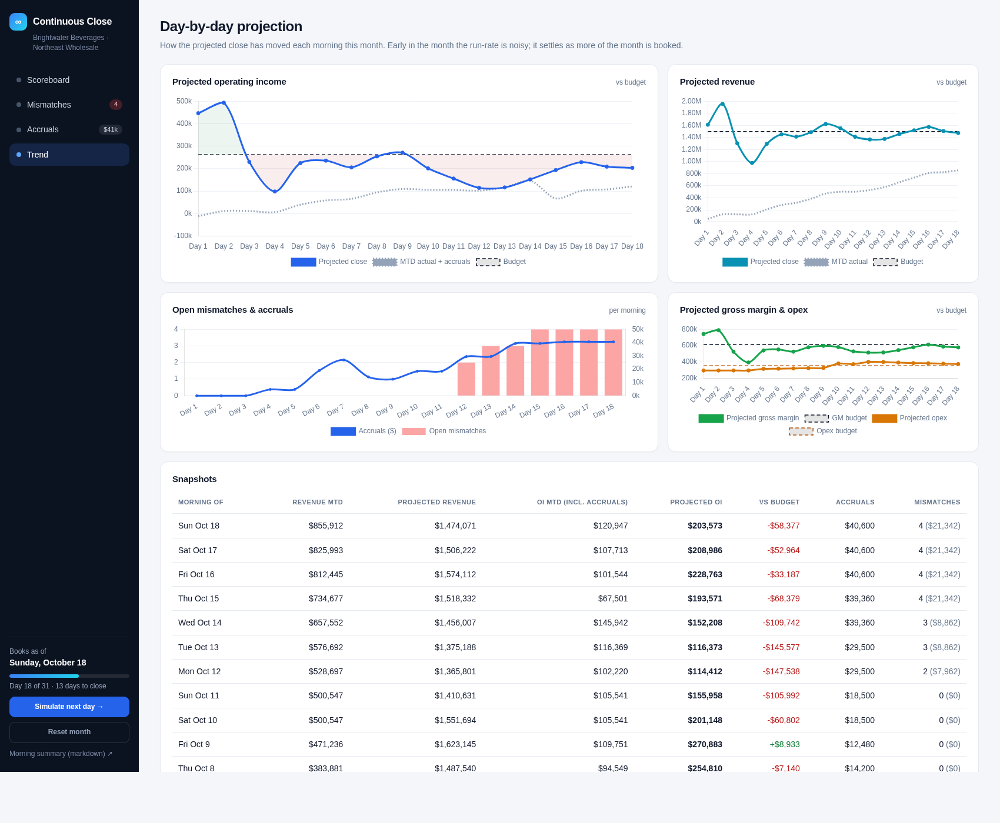

# Continuous Close

> Every morning the CFO gets one answer: **"If the month ended today, here's where we'd be — and here's where we'll likely finish."**

A small, self-contained finance demo for a fictional company (**Brightwater Beverages / Northeast Wholesale** segment). Instead of waiting until month-end, a daily pipeline loads the books into DuckDB, reconciles them against the bank, proposes accruals, and projects the month-end close against budget — then shows it all on a four-view dashboard and in a markdown morning summary.

Everything is fake data generated locally. No external services, no credentials.



## What it does

| Step | What happens |
|---|---|
| **Daily pipeline** (`cc pipeline`) | Loads the general ledger, bank statement, purchase orders, receipts and budget CSVs into a local DuckDB file, then runs reconciliation, accruals and the projection for every day of the month so the trend is always complete. |
| **Reconciliation** | Matches book cash lines to bank transactions (same reference + amount, then same counterparty + amount within 5 days). Matches are auto-cleared; whatever is left is classified with a likely reason and a suggested entry: *timing difference, duplicate payment, amount mismatch / transposition, unrecorded bank fee, unknown bank item, stale outstanding item*. |
| **One accrual rule** | **GRNI** — goods received on a PO with no vendor invoice posted yet. Accrues the received-not-invoiced amount to the PO's expense account / Accrued Liabilities. |
| **Projected close** | `actuals + accruals + forecast for the rest of the month`, compared to budget. Variable lines use a simple daily run-rate; fixed lines (rent, payroll, insurance, software…) fill the remainder to budget. |
| **Dashboard** (`cc serve`) | Four views: **Scoreboard**, **Mismatches**, **Accruals**, **Trend**. Buttons to simulate the next day and to reset the demo. |
| **Morning summary** (`cc summary`) | A short markdown brief: headline projection vs budget, what's driving the variance, open mismatches with actions, accruals, and today's asks. |
| **Simulate next day** (`cc simulate-day`) | Appends one day of new invoices, receipts, bills, payments and bank activity, moves POs along (receipts arrive, invoices land and reverse accruals), plants 1–2 new mismatches, and re-runs the pipeline. |

### The seed data

- One segment, 21 GL accounts (16 P&L + cash, AR, inventory, AP, accrued liabilities), the current month through **day 18**.
- `data/general_ledger.csv`, `data/bank_statement.csv`, `data/purchase_orders.csv`, `data/receipts.csv`, `data/budget.csv`, `data/chart_of_accounts.csv`.
- Four planted problems, all found by the pipeline:

| Planted problem | How it shows up |
|---|---|
| **Timing difference** | Check to Keystone Packaging booked on the 15th, not yet cleared by the bank. |
| **Duplicate payment** | Harborline Logistics debited twice by the bank under one payment reference; only one payment booked. |
| **Amount typo** | Summit Glassworks payment booked as 8,750 but cleared as 7,850 — flagged as a digit transposition. |
| **Unrecorded bank fee** | A 22.50 FX conversion fee on the statement with nothing posted to Bank Fees. |

Plus four open GRNI accruals (POs received but not invoiced) totalling about $40.6k.

## Run it

Requires Python 3.11+.

```bash
python -m venv .venv && source .venv/bin/activate
pip install -e ".[dev]"

cc demo          # generate seed data -> run pipeline -> print the morning summary
cc serve         # dashboard at http://localhost:8000
```

Individual commands:

```bash
cc generate                 # (re)create the fake data through day 18 (resets the demo)
cc pipeline                 # load CSVs into continuous_close.duckdb, reconcile, accrue, project
cc summary                  # print the morning summary in markdown
cc summary --out out/morning-summary.md
cc simulate-day             # add a day of transactions + 1-2 new mismatches, then re-run the pipeline
cc simulate-day --seed 7    # deterministic variant
cc serve --port 8000        # web dashboard (also exposes /summary.md and /api/scoreboard)
```

By default the data is generated for the current calendar month. Pin it with `CC_MONTH=2026-10 cc demo` if you want a reproducible month (the committed `data/` and screenshots use October 2026).

Tests:

```bash
pytest
```

## The four views

**Scoreboard** — projected close vs budget for revenue, cost of sales, gross margin, opex and operating income; each line split into MTD actuals, accruals and forecast, with a mini trend and the items that need attention today.


**Mismatches** — books vs bank side by side, auto-clear rate, and every open item with a likely reason and the suggested entry.



**Accruals** — proposed GRNI entries with the journal lines, plus the status of every open PO (received / invoiced / accrual).



**Trend** — day-by-day projection of operating income, revenue, gross margin and opex against budget, alongside open mismatches and accruals per day.



## Morning summary

`cc summary` writes something like this (full example in [docs/morning-summary-example.md](docs/morning-summary-example.md)):

```markdown
# Continuous Close - morning summary for Sunday, October 18

**Brightwater Beverages / Northeast Wholesale** - day 18 of 31 (58% of the month elapsed)

If the month ended today we would be at $120,947 operating income. We are tracking to
finish at **$203,573** vs a budget of $261,950 (-$58,377, -22.3% unfavorable).

## Bank reconciliation
- 53 of 57 cash items auto-cleared (93.0%), $1,226,746 matched.
- 4 open mismatches totalling $21,342:
  - **Duplicate payment** (high) - Harborline Logistics, $7,940: The bank debited ... twice ...
  - **Amount mismatch** (high) - Summit Glassworks, $900: ... a transposition keying error.
  ...
```

## How it's built

```
continuous_close/
  datagen.py      synthetic GL / bank / PO / receipts / budget, planted mismatches, simulate_next_day
  db.py           DuckDB schema + CSV loading
  recon.py        bank reconciliation: matching rules + mismatch classification
  accruals.py     GRNI accrual rule
  projection.py   actuals + accruals + forecast vs budget, P&L rollups
  pipeline.py     the daily run (with day-by-day backfill for the trend)
  reporting.py    queries shared by the dashboard and the summary
  summary.py      markdown morning summary
  cli.py          `cc` commands (Typer)
  web/            FastAPI + Jinja2 dashboard, Chart.js (vendored), no build step
tests/            pytest: reconciliation rules, accrual rule, projection math, end-to-end pipeline, dashboard routes
```

Stack: Python, DuckDB, FastAPI, Jinja2, Typer, Chart.js. The DuckDB file (`continuous_close.duckdb`) is created on first pipeline run and is git-ignored.
